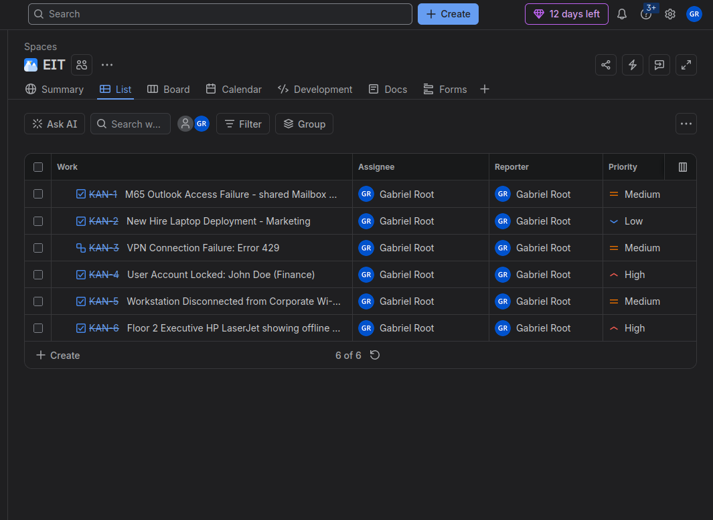

# Jira Help Desk Ticketing Lab

A hands-on lab where I used Jira to log, prioritize, and work through realistic IT help desk tickets, the same kind of requests a support team handles every day.

## Lab Overview

- **Tool:** Jira (project "EIT")
- **Views used:** List and Board
- **Tickets:** 6 tickets covering email, VPN, account access, new hire setup, networking, and printers
- **Priorities used:** Low, Medium, and High, assigned by business impact

## Tickets

| Key | Ticket | Category | Priority |
|---|---|---|---|
| KAN-1 | M365 Outlook access failure (shared mailbox) | Email / Microsoft 365 | Medium |
| KAN-2 | New hire laptop deployment (Marketing) | Service request | Low |
| KAN-3 | VPN connection failure: Error 429 | Remote access | Medium |
| KAN-4 | User account locked: John Doe (Finance) | Account access | High |
| KAN-5 | Workstation disconnected from corporate Wi-Fi | Networking | Medium |
| KAN-6 | Floor 2 executive HP LaserJet showing offline | Hardware / printing | High |

## How I Prioritized

- **High:** blocks someone from working, or affects an executive or a whole department (account lockout, shared printer offline)
- **Medium:** work is slowed but there is a workaround (email access, Wi-Fi, VPN)
- **Low:** planned or non-urgent work (new hire laptop setup)

## What This Lab Shows

- Writing clear ticket titles and descriptions
- Setting priority based on business impact
- Tracking work from open to done
- Documenting troubleshooting steps and the resolution
- Handling a range of common help desk issues

## Related Lab

The account lockout ticket (KAN-4) pairs with my [Active Directory lab](https://github.com/coconutzeus12-web/Helpdesk-ad-lab), where I set up a lockout policy and unlocked the account myself.
## Screenshots

