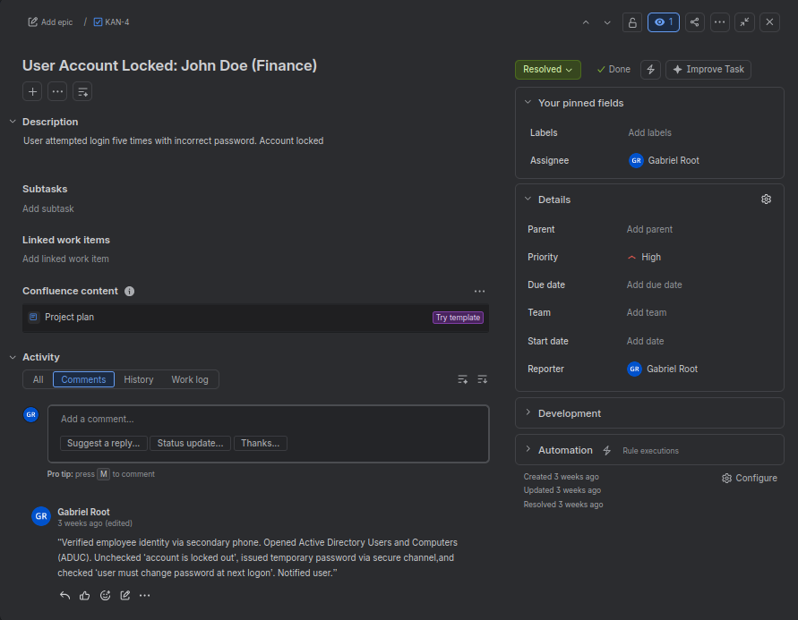

# KAN-4: User Account Locked (Finance)

**Priority:** High
**Status:** Resolved
**Category:** Account access

## Issue
A Finance user tried to log in five times with an incorrect password, and the account was locked out.

## Steps Taken
1. Verified the employee's identity through a secondary phone contact before making any changes.
2. Opened **Active Directory Users and Computers (ADUC)** and found the user's account.
3. Cleared the **account is locked out** setting on the Account tab to unlock the account.
4. Issued a temporary password through a secure channel.
5. Checked **User must change password at next logon** so the user sets their own password.
6. Notified the user that the account was unlocked.

## Result
The account was unlocked and the user could sign in again. Ticket resolved.

## Why High Priority
A Finance user who can't log in can't do their work, so the account was unlocked quickly.

## Lessons Learned
- Always verify identity before unlocking an account or issuing a password.
- Send temporary passwords through a secure channel, and force a change at next logon.

## Related
I practiced the same fix in my [Active Directory lab](https://github.com/coconutzeus12-web/Helpdesk-ad-lab), including setting the lockout policy.

